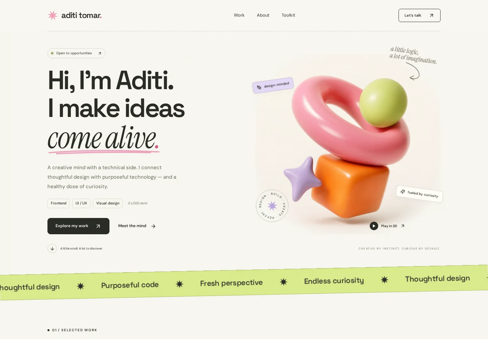

# Aditi Tomar — Creative Portfolio

**A creative mind. A technical side.**



A complete, responsive portfolio for a fresher exploring **frontend development, UI/UX, graphic design, and other creative/technical roles**. Warm ivory, pink, lime, orange, oversized typography, sculptural 3D artwork — no blue-on-dark developer template.

## What’s included

- **React + Vite frontend:** responsive navigation, role-flexible introduction, selected work, about, technical skills, design interests, professional strengths, and contact.
- **Three.js playground:** real WebGL 3D shapes, pointer orbit, keyboard controls, reset and remix. Decorative motion can be switched off. Artwork is the fallback if WebGL is unavailable.
- **Dynamic projects:** MongoDB-backed listings, category filters, technology search, details, original live links and repositories. New `frontend` or `design` projects automatically create the appropriate filter.
- **Express + Mongoose backend:** project reads, validated contact submissions, optional SMTP notifications, JWT-protected administration.
- **Private studio at `/studio`:** add/edit/delete projects; read, reply to, mark and delete contact messages.
- **Your five original projects:** EmployeeMS, Bhoomi Homestay, Nitin Hydraulics Website, ShopEase, and File Converter with AI Q&A.
- **Non-destructive seed:** repeatable upserts by slug. No `deleteMany()` and no startup seeding.
- Self-hosted fonts, artwork, tests, environment template, Dockerfile, and deployment configurations.

## 1. Run it locally

You need **Node.js 20.19+** (Node 22 LTS recommended) and npm.

```bash
cd aditi-portfolio
npm ci
```

Create your private `.env` in the project root:

```bash
# macOS / Linux
cp .env.example .env
```

```powershell
# Windows PowerShell
Copy-Item .env.example .env
```

```bash
npm run dev
```

- **Portfolio:** http://localhost:5173
- **Studio:** http://localhost:5173/studio
- **API health:** http://localhost:3001/api/health

One command starts both frontend and backend. The frontend uses a Vite proxy for `/api`, so you do **not** need to change frontend URLs for local development.

### It works before you connect MongoDB

With `MONGODB_URI` empty, the server explicitly runs in **demo mode** and returns your five seed projects. The site can be explored normally. Database writes, contact delivery, and project administration are intentionally unavailable — the app never pretends to have sent a message.

If a configured live API fails, the frontend displays saved project previews with a reconnect notice. If a connected database is empty, it displays an empty state instead of pretending demo projects are stored there.

## 2. Connect your existing MongoDB

Put your connection details in the root `.env` **on your own machine or backend host**. Never send credentials through the website or commit them to Git.

```dotenv
MONGODB_URI=mongodb+srv://<db-user>:<url-encoded-password>@<cluster-host>/<database-name>?retryWrites=true&w=majority
PROJECT_COLLECTION=projects
```

- Use **the same database you already seeded**.
- If your URI doesn’t select a database, set `MONGODB_DB_NAME` explicitly.
- Mongoose’s default `Project` collection is `projects`; this project uses that name unless you change `PROJECT_COLLECTION`.
- Your existing `title`, `slug`, `summary`, `highlights`, `stack`, `category`, `liveUrl`, `repoUrl`, `featured`, and `order` fields work directly.
- `imageUrl` is an optional extension. Existing documents do not need it. With no image URL, the frontend uses the built-in illustrated cover.
- Allow your machine or backend host in Atlas **Network Access** and use a database user with appropriate read/write access. Prefer specific IP access; do not leave unrestricted access as a permanent shortcut.
- Restart the server after editing `.env`.

**Already seeded? Skip the next command.** If you want to add/update the original five projects:

```bash
npm run seed
```

This updates those five slugs but keeps unrelated projects. It will overwrite edited values for the original five projects, so don’t reseed after personalizing them unless that’s intentional.

The models and seed use modern **ES modules** (`import`), rather than CommonJS (`require`). Both client and server share `shared/projects.js` as the original data source.

## 3. Enable your private admin studio

Add these **server-only** settings to `.env`:

```dotenv
ADMIN_PASSWORD=<a-unique-password-with-at-least-12-characters>
JWT_SECRET=<a-random-secret-with-at-least-32-characters>
```

Generate a strong signing secret locally:

```bash
node -e "console.log(require('node:crypto').randomBytes(48).toString('hex'))"
```

Restart, then open **http://localhost:5173/studio** and enter the password.

- No hardcoded admin password is included.
- Admin remains disabled until **both** credentials meet their length requirements.
- JWTs expire after two hours and are held in `sessionStorage` (or in memory if browser storage is blocked), not a cookie or a URL. Sign out clears the current browser’s stored token; any previously copied token remains valid until expiry. Rotating `JWT_SECRET` invalidates all outstanding tokens.
- MongoDB must be connected for editing or reading the inbox.
- Project slugs must be unique, lowercase, and hyphen-separated.
- Choose **Design** or **Frontend** when you add genuine future work. No design case studies or client achievements have been invented for this portfolio.

## 4. Personalize your profile

Edit **`client/src/lib/profile.js`**:

- Introduction, about paragraphs, role labels and availability.
- Technical skills, design interests, and professional strengths.
- Your real public email, LinkedIn and résumé URL. Empty values are hidden, so no fake contact links appear.

The strengths and introductory copy are suggested portfolio copy: **review them against your actual experience before publishing**. Design topics are clearly described as interests, not certified expertise. No fake employment, degree, years of experience, or percentages are shown.

To add a résumé, place your actual file at `client/public/resume.pdf` and set:

```js
resumeUrl: '/resume.pdf';
```

Update the page title/description in **`client/index.html`** and the headline copy in **`client/src/App.jsx`** if needed. Colors and responsive styles are in **`client/src/styles.css`**.

### Artwork

The hero sculpture is **AI-generated decorative artwork**, not a portrait or a work sample. Project covers are **CSS concept illustrations**, labeled as such — not actual website screenshots. Each project’s live link leads to its actual site. You can replace covers with your own screenshots using `imageUrl` in the studio, or customize `ProjectArt.jsx`.

Self-hosted Space Grotesk, DM Sans and Instrument Serif fonts have their respective SIL Open Font License files in `client/public/fonts/`. No CDN is needed at runtime.

## 5. Contact form and optional email

Contact messages are genuinely stored in MongoDB’s `messages` collection and appear in `/studio`. SMTP is **optional**; without it, use the studio to read inquiries. The reply button opens your email application.

To receive an email notification as well, configure:

```dotenv
SMTP_HOST=<your-smtp-host>
SMTP_PORT=587
SMTP_SECURE=false
SMTP_USER=<smtp-username>
SMTP_PASS=<smtp-password-or-app-password>
SMTP_FROM=<your-verified-sender-address>
CONTACT_EMAIL=<your-inbox-address>
```

For implicit TLS on port 465, set `SMTP_SECURE=true`. Use the credentials and verified sender supplied by your email provider. A saved message stays in MongoDB even if a notification fails. No SMTP credentials or email inbox were available for provider-specific delivery testing.

Messages have no automatic expiration; delete them in the studio when no longer needed. Add a privacy notice appropriate for your audience before collecting personal data publicly.

## 6. Production

### Recommended: frontend + backend on one host

```bash
npm ci
npm run build
npm start
```

Set `NODE_ENV=production` on your host. Express serves the built site from `client/dist` and the API from `/api`. Leave `VITE_API_BASE_URL` empty. Open the host’s assigned port; local default is **3001**.

The included **`render.yaml`** is a blueprint for a single Render web service. Set your private MongoDB URI and admin password in the host’s environment settings. It generates a JWT secret and enables one trusted reverse proxy. Hosting plan availability and limits depend on your provider; the configuration is a starting point, not an already-deployed service.

If your host uses one trusted proxy, set `TRUST_PROXY=true`; otherwise leave it false. This matters for per-visitor rate limits.

### Alternative: Vercel frontend + separate backend

The included **`vercel.json`** builds only the Vite frontend and supports direct `/studio` visits.

1. Deploy the API to a Node-capable host with `npm ci && npm run build` / `npm start`.
2. On the frontend host, set `VITE_API_BASE_URL=https://your-api-host.example/api` **before building**.
3. On the backend, set `CLIENT_ORIGIN=https://your-frontend-host.example`. Multiple exact origins can be comma-separated. Add preview deployment origins explicitly when needed.
4. Keep `MONGODB_URI`, `ADMIN_PASSWORD`, `JWT_SECRET` and SMTP credentials only on the backend.
5. Rebuild the frontend if you change `VITE_API_BASE_URL`.

**Never put secrets in a `VITE_` variable**; Vite exposes those values in the browser bundle.

### Docker

```bash
docker build -t aditi-portfolio .
docker run --rm -p 3001:3001 --env-file .env -e NODE_ENV=production aditi-portfolio
```

Use production values in the runtime environment (`NODE_ENV=production`). The container listens on 3001 unless you override `PORT`. For local port 3001 mapping, keep `PORT=3001`. The image runs as an unprivileged user and excludes `.env`.

## API overview

Successful list responses use `{ "projects": [...], "source": "mongodb" | "demo" }`. Detailed API reference: **[docs/API.md](docs/API.md)**.

| Method               | Endpoint                    | Access                                   |
| -------------------- | --------------------------- | ---------------------------------------- |
| GET                  | `/api/health`               | Public                                   |
| GET                  | `/api/projects`             | Public; optional `category` / `featured` |
| GET                  | `/api/projects/:slug`       | Public                                   |
| POST                 | `/api/contact`              | Public; MongoDB required                 |
| POST                 | `/api/admin/login`          | Password                                 |
| GET                  | `/api/admin/me`             | JWT                                      |
| POST / PUT / DELETE  | `/api/admin/projects[/:id]` | JWT + MongoDB                            |
| GET / PATCH / DELETE | `/api/admin/messages[/:id]` | JWT + MongoDB                            |

Safety includes validation, http(s)-only project URLs, CORS, security headers, body size limits, login/contact rate limits, honeypot validation, timing-safe password comparison, unique slugs, and safe error responses. Deploy over HTTPS, use strong credentials, and keep dependencies updated. Single-instance in-memory rate limiting is appropriate for a small portfolio; use a shared rate-limit store if scaling across instances.

## Project structure

```text
aditi-portfolio/
├── client/
│   ├── public/             # Local fonts, sculpture, favicon
│   ├── src/
│   │   ├── components/     # Project art/dialogs, 3D playground, admin
│   │   ├── hooks/          # Project API loading and reconnect fallback
│   │   ├── lib/            # Editable profile and API client
│   │   ├── App.jsx         # Portfolio sections
│   │   ├── main.jsx
│   │   └── styles.css
│   └── index.html
├── server/
│   ├── lib/                # Auth, validation, optional mail
│   ├── models/             # Project and Message schemas
│   ├── tests/              # API and validation tests (no DB needed)
│   ├── app.js
│   ├── index.js
│   └── seed.js
├── shared/projects.js      # Your five original projects
├── docs/API.md
├── .env.example
├── Dockerfile
├── render.yaml
├── vercel.json
├── vite.config.js
├── package.json
└── package-lock.json
```

## Checks

See [verification notes](docs/TESTING.md) for the completed checks.

```bash
npm test          # 13 API/validation tests, no MongoDB required
npm run build     # Production compilation
npm run check     # Both
npm audit         # Dependency security check
```

The implementation was also tested end-to-end against a **temporary local MongoDB**, including real contact persistence, JWT sign-in, project create/update/delete, inbox read/delete, newly added Design filters, WebGL controls, mobile navigation, motion preferences, and layouts from 360px to 1440px. No access to your MongoDB was needed or used.

The ZIP contains source and a lockfile, **not** `node_modules`, secrets, or a preconfigured database. Install dependencies and add your own `.env` to run it.
